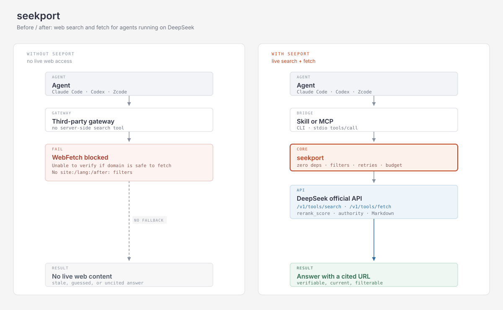

<p align="right"><a href="README.md"></a></p>

<h1 align="center">seekport</h1>

<p align="center"><strong>Bridge DeepSeek's official Search / Fetch API to any agent</strong></p>
<p align="center">Any model · any harness · zero dependencies · Agent Skill + MCP · search candidates, then fetch the primary source</p>
<p align="center"><strong>v0.1.3 — Full-width Tables and Bilingual About</strong></p>

<p align="center">
  <a href="https://github.com/ChemistryBus/seekport/actions/workflows/test.yml"></a>
  <a href="https://github.com/ChemistryBus/seekport/releases"></a>
  <a href="LICENSE"></a>
  
  
  
</p>



## What it is

Search tools are not scarce. The hard part is **getting an agent to a citable primary source across third-party gateways and different harnesses**.

`seekport` is not a crawler and not a search engine. It is a thin bridge: it sends a query or a URL to DeepSeek's official Search / Fetch API, gets back ranked results or Markdown, and hands them to the agent.

**It does not require DeepSeek as the model.** As long as `DEEPSEEK_API_KEY` has credit, Claude, GPT, DeepSeek, and local models all work; so do Claude Code, Codex, Zcode, Cursor, or your own harness. Search / Fetch is a separate paid API, billed independently of model calls.

It solves these concrete problems:

- Behind a third-party gateway, Claude Code's `WebFetch` returns `Unable to verify if domain is safe to fetch`;
- The harness has no usable web search, or cannot use DeepSeek's `site:` / `lang:` / `after:` operators and `rerank_score` / `authority` filters;
- The agent can only cite secondary articles, which may be stale;
- Harnesses differ: some can run shell commands, some can only call MCP tools;
- Your model is not DeepSeek, but you want DeepSeek's official Search / Fetch.

**What it is not**: not a crawler (no HTML parsing, link following, or indexing); not a general search engine; not PubMed / Web of Science / Scopus; not an official DeepSeek project.

How it relates to other tools: DSH users should use `@deepseek-ai/dsh-web-deepseek-api`; OpenCode / Pi has `deepseek-web-retrieval`; general MCP has `@wangkh/deepseek-search-mcp`; pure skill has `namelessgod2008/deepseek-search`. seekport's difference is the combination: non-DSH harnesses + a standard Skill + zero dependencies + filtering and a spend cap.

## Quick start (30 seconds)

### Prerequisite: a funded DeepSeek API key

1. Create a key at <https://platform.deepseek.com/api_keys>.
2. Top up the account. Search / Fetch is a paid API: ¥5 per 1,000 successful requests, about ¥0.005 per call; empty results and failures are free.
3. Put the key in your environment; do not paste it into chat:

```bash
export DEEPSEEK_API_KEY=sk-...
```

Or write it to `~/.config/seekport/env` (`chmod 600`) and load it with `set -a; . ~/.config/seekport/env; set +a`.

4. If you use DSH: use the official `@deepseek-ai/dsh-web-deepseek-api` package. You do not need seekport.

### Option 1: let an agent install it

Paste this into Claude Code / Codex / Zcode:

```text
Install the seekport Agent Skill. First confirm that writing to ~/.claude/skills is allowed, then:
1. git clone https://github.com/ChemistryBus/seekport.git ~/seekport
2. ln -s ~/seekport ~/.claude/skills/seekport
3. Check that SKILL.md and scripts/cli.py exist
4. Check whether DEEPSEEK_API_KEY is set (do not print the key)
5. If it is not set, tell me where to export it or write it to ~/.config/seekport/env
Do not read or upload my API key.
```

If the key is already in `~/.config/seekport/env`, you can say:

```text
My DeepSeek key is in ~/.config/seekport/env. Load it (do not print the key),
then search with seekport for "Nutrients author guidelines site:mdpi.com" and show me the candidates.
```

### Option 2: manual install

```bash
git clone https://github.com/ChemistryBus/seekport.git ~/seekport
ln -s ~/seekport ~/.claude/skills/seekport
export DEEPSEEK_API_KEY=sk-...
```

Restart Claude Code, then say:

> Use seekport to look up the latest Nutrients author guidelines.

### After install: how to use it

```text
Search with seekport for "Nutrients author guidelines site:mdpi.com"; show me the candidates first.
After I pick one, fetch the official page and give me the URL.
```

### Try one search

```bash
python3 scripts/cli.py search "Nutrients author guidelines site:mdpi.com" --md
python3 scripts/cli.py fetch "https://api-docs.deepseek.com/zh-cn/guides/search" --md
```

No `pip install`. Requires Python 3.9+.

## How to search

<table width="100%">
  <thead><tr><th width="24%">Task</th><th width="46%">Recommended form</th><th width="30%">Why</th></tr></thead>
  <tbody>
    <tr><td>Journal guidelines</td><td><code>site:mdpi.com</code> + keywords</td><td>Restrict the site; fewer irrelevant results</td></tr>
    <tr><td>Official API docs</td><td><code>site:api-docs.deepseek.com</code></td><td>Primary source, not secondary articles</td></tr>
    <tr><td>Recent work</td><td><code>after:2025 lang:en</code></td><td>Restrict year and language</td></tr>
    <tr><td>Cite the source</td><td><code>fetch &lt;url&gt;</code></td><td>Search gives candidates; the page is citable</td></tr>
    <tr><td colspan="3">Note: search returns candidates; read the summary first. To cite, fetch the specific URL. Combine multiple sites with OR, e.g. site:github.com OR site:huggingface.co.</td></tr>
  </tbody>
</table>

```bash
# 1. Journal author guidelines
python3 scripts/cli.py search "Nutrients author guidelines site:mdpi.com" --md

# 2. Official API docs
python3 scripts/cli.py search "DeepSeek pricing site:api-docs.deepseek.com" --md

# 3. Recent work in a field
python3 scripts/cli.py search "exercise metabolism after:2025 lang:en" --md

# 4. Fetch the primary source
python3 scripts/cli.py fetch "https://api-docs.deepseek.com/zh-cn/guides/search" --md
```

<table width="100%">
  <thead><tr><th width="30%">Operator</th><th width="70%">Meaning</th></tr></thead>
  <tbody>
    <tr><td><code>site:</code></td><td>Restrict to a site</td></tr>
    <tr><td><code>-site:</code></td><td>Exclude a site</td></tr>
    <tr><td><code>"..."</code></td><td>Exact phrase</td></tr>
    <tr><td><code>-term</code></td><td>Exclude a term</td></tr>
    <tr><td><code>lang:zh,en</code></td><td>Restrict language</td></tr>
    <tr><td><code>after:</code> / <code>before:</code></td><td>Restrict by date</td></tr>
    <tr><td colspan="2">Note: operators can be combined with spaces and are passed through to DeepSeek unchanged; quoted phrases may contain spaces, and -term excludes a term.</td></tr>
  </tbody>
</table>

<table width="100%">
  <thead><tr><th width="30%">Flag</th><th width="70%">Meaning</th></tr></thead>
  <tbody>
    <tr><td><code>--count</code></td><td>1–50 results, default 10; does not change the per-call price</td></tr>
    <tr><td><code>--min-rerank</code></td><td>Drop results below this score, default 1.5; <code>0</code> keeps everything</td></tr>
    <tr><td><code>--min-authority</code></td><td>Drop results below this authority; <code>3</code>–<code>4</code> is highly authoritative</td></tr>
    <tr><td><code>--md</code></td><td>Markdown instead of JSON</td></tr>
    <tr><td><code>--content</code></td><td>Ask the API for full page text (larger, slower)</td></tr>
    <tr><td><code>--ori-question</code></td><td>The user's original question, for intent matching</td></tr>
    <tr><td colspan="2">Note: --count changes result count, not price. --min-rerank 0 keeps all scored results; --min-authority 3 keeps highly authoritative pages. Filtering happens locally.</td></tr>
  </tbody>
</table>

## Who it's for / not for

**For:**

- Claude Code / Codex / Zcode / Cursor, or your own harness;
- Any model: Claude, GPT, DeepSeek, or a local model, as long as `DEEPSEEK_API_KEY` has credit;
- People behind a third-party gateway where `WebFetch` is blocked;
- Researchers who need official docs, journal guidelines, or conference deadlines;
- Anyone who wants results filtered before they reach the model.

**Not for:**

- DSH users: the official `@deepseek-ai/dsh-web-deepseek-api` package is better;
- PubMed / Web of Science / Scopus-style literature databases;
- Bulk crawling, indexing, or scheduled scraping;
- People who do not want to pay for the DeepSeek API;
- Environments without Python 3.9+ or network access.

## Core capabilities

<table width="100%">
  <thead><tr><th width="30%">Capability</th><th width="70%">What it does</th></tr></thead>
  <tbody>
    <tr><td>Filtered search</td><td>Supports <code>site:</code> / <code>lang:</code> / <code>after:</code>; drops <code>rerank_score &lt; 1.5</code> by default; <code>--min-authority 3</code> keeps highly authoritative pages</td></tr>
    <tr><td>Fetch the source</td><td>Turns a URL into Markdown for the agent to summarise or cite</td></tr>
    <tr><td>Two shapes</td><td>Agent Skill or stdio MCP server (<code>deepseek_search</code> / <code>deepseek_fetch</code>), sharing one core</td></tr>
    <tr><td>Cost guardrails</td><td>Retries 408 / 429 / 5xx; refuses redirects; optional daily cap via <code>SEEKPORT_BUDGET</code></td></tr>
    <tr><td>Zero dependencies</td><td>Python 3.9+ standard library only; the core <code>scripts/ds_core.py</code> is 290 lines</td></tr>
    <tr><td colspan="2">Note: the core lives in scripts/ds_core.py and is shared by the CLI and MCP server. The 81 tests mock all HTTP, so they spend no credits; zero dependencies means the standard library only.</td></tr>
  </tbody>
</table>

## Evidence, not "accuracy"

Ask an agent: "How much does DeepSeek's Search API cost, and what are its QPS limits?" Behind a third-party gateway, `WebFetch` on the official docs returns:

> Unable to verify if domain is safe to fetch.

Search returned secondary articles; two of the top three still claimed **$0.75 / 1,000 and 5 QPS**. Fetching the primary source with seekport showed **¥5 / 1,000, Search 100 QPS / Fetch 25 QPS**.

This is the developer's real run, not a third-party user case and not a general accuracy claim. One search + one fetch costs about **¥0.01**. Full transcript: [examples/case-study.md](examples/case-study.md).

## Supported harnesses

<table width="100%">
  <thead><tr><th width="30%">Harness</th><th width="70%">Status</th></tr></thead>
  <tbody>
    <tr><td>Claude Code</td><td>Verified (Skill + CLI)</td></tr>
    <tr><td>Codex</td><td>Install instructions written; not verified inside the client</td></tr>
    <tr><td>Zcode</td><td>Install instructions written; not verified inside the client</td></tr>
    <tr><td>Any MCP client</td><td>MCP stdio verified; suits harnesses that cannot run shell commands</td></tr>
    <tr><td colspan="2">Note: Claude Code, the CLI, and MCP stdio are verified. Codex and Zcode have install instructions but were not verified inside those clients; Windows is untested. Install one shape per harness.</td></tr>
  </tbody>
</table>

Platforms: macOS tested; Linux covered by CI (Python 3.9 / 3.11 / 3.12); Windows untested.

Install one shape per harness: Skill when the harness can run shell commands; MCP when it cannot.

## Install options

**Skill (Claude Code / Codex / Zcode)**

```bash
git clone https://github.com/ChemistryBus/seekport.git ~/seekport
ln -s ~/seekport ~/.claude/skills/seekport
```

**MCP (clients without shell access)**

```bash
claude mcp add seekport -- python3 "/absolute/path/to/seekport/mcp/seekport_mcp.py"
```

**CLI (direct use)**

```bash
python3 scripts/cli.py search "..." --md
python3 scripts/cli.py fetch "https://..." --md
```

## Cost and limits

<table width="100%">
  <thead><tr><th width="30%">Item</th><th width="70%">Value</th></tr></thead>
  <tbody>
    <tr><td>Search</td><td><strong>¥5 per 1,000 successful requests</strong></td></tr>
    <tr><td>Fetch</td><td><strong>¥5 per 1,000 successful requests</strong></td></tr>
    <tr><td>Approx. per call</td><td>¥0.005 ≈ <strong>$0.0007</strong></td></tr>
    <tr><td>Billed when</td><td>HTTP 200 <strong>and</strong> non-empty results (Search) / content (Fetch)</td></tr>
    <tr><td>Not billed</td><td>Errors, timeouts, empty searches</td></tr>
    <tr><td>Rate limits</td><td>Search <strong>100 QPS</strong>, Fetch <strong>25 QPS</strong> per account</td></tr>
    <tr><td colspan="2">Note: prices and limits follow DeepSeek's official docs. Only HTTP 200 responses with non-empty results are billed; errors, timeouts, and empty searches are free. Set SEEKPORT_BUDGET to cap daily spend.</td></tr>
  </tbody>
</table>

`--count` changes the number of results, not the price. Set `SEEKPORT_BUDGET=0.05` to cap daily spend at ¥0.05 (10 successful calls); the ledger lives at `~/.cache/seekport/spend.log`. Prices and limits can change; check the [official docs](https://api-docs.deepseek.com/zh-cn/guides/search) before quoting them.

## FAQ

**How is this different from `@deepseek-ai/dsh-web-deepseek-api`?**

DSH users should use the official package. seekport is for non-DSH harnesses, third-party gateways, and people who want explicit filters and a local spend cap.

**Is it free?**

The tool is MIT. DeepSeek's Search / Fetch API is paid: about ¥0.005 per call; empty results and errors are free.

**Can I use it without a DeepSeek model?**

Yes. seekport reads only `DEEPSEEK_API_KEY`; neither the model nor the harness is bound. DeepSeek's Search / Fetch is a separate API, billed independently of model calls.

**How do I get and top up an API key?**

Create a key at <https://platform.deepseek.com/api_keys> and add credit in the DeepSeek platform. Search / Fetch is billed per successful request; HTTP 402 means the balance is insufficient.

**Does it work on Windows?**

The code is standard library only, but Windows is untested. macOS and Linux CI are tested.

**Have Codex and Zcode been verified?**

The install instructions are written. The live tests were Claude Code (Skill), the CLI, and MCP stdio. Codex and Zcode have not been verified inside those clients.

**Why does WebFetch fail?**

A third-party gateway cannot verify the target domain. seekport sends the URL to DeepSeek's Fetch API, which fetches it server-side.

**What if a fetch fails?**

You may get 403 / 404, or the site may have a paywall or anti-bot policy. Try another URL, or use the search result's `summary`.

**Does it write my API key anywhere?**

No. The key is read from `DEEPSEEK_API_KEY`; the repo contains no key; redirects are refused so the bearer token is never forwarded to another origin.

## Docs

<table width="100%">
  <thead><tr><th width="30%">Topic</th><th width="70%">Link</th></tr></thead>
  <tbody>
    <tr><td>Chinese README</td><td><a href="README.md">README.md</a></td></tr>
    <tr><td>Skill</td><td><a href="SKILL.md">SKILL.md</a></td></tr>
    <tr><td>Real case study</td><td><a href="examples/case-study.md">examples/case-study.md</a></td></tr>
    <tr><td>Maintenance checklist</td><td><a href="MAINTENANCE.md">MAINTENANCE.md</a></td></tr>
    <tr><td>Contributing</td><td><a href="CONTRIBUTING.md">CONTRIBUTING.md</a></td></tr>
    <tr><td>Xiaohongshu / video assets</td><td><a href="promo/README.md">promo/README.md</a></td></tr>
    <tr><td>Release notes</td><td><a href="https://github.com/ChemistryBus/seekport/releases">GitHub Releases</a></td></tr>
    <tr><td colspan="2">Note: the Chinese README is the default; English lives in README.en.md. SKILL.md is the installed skill's instructions; examples/ contains real transcripts; promo/ contains the Xiaohongshu and video assets.</td></tr>
  </tbody>
</table>

## Development and tests

```bash
python3 -m unittest discover -s tests -v
```

81 tests, 93% line coverage, CI on Python 3.9 / 3.11 / 3.12. All HTTP is mocked; the suite spends no credits.

## Acknowledgements

Search and fetch are powered by DeepSeek's official Search/Fetch API. This project was developed with Claude Code running on a DeepSeek model. These are tools, not authors: the GitHub contributors list reflects the people who wrote commits, not the models or APIs used.

## License

MIT. Not affiliated with DeepSeek.
