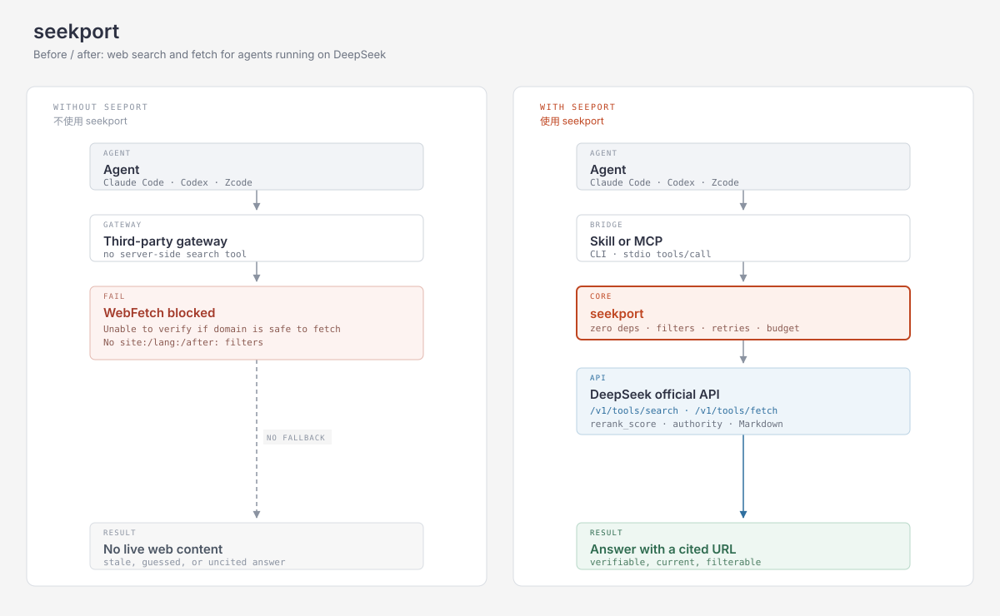

🌐 **English** | [简体中文](README.zh-CN.md)

# seekport

**Bridge DeepSeek's official Search/Fetch API to Claude Code, Codex, Zcode, and any other agent harness.**

`seekport` is a thin, zero-dependency bridge to DeepSeek's official
[Search and Fetch APIs](https://api-docs.deepseek.com/zh-cn/guides/search). It
gives an agent real web search and page fetch even when the harness's built-in
`WebFetch` or search is blocked. It exists for one concrete failure:

> Unable to verify if domain is safe to fetch.

That is what Claude Code's `WebFetch` says when it runs through a third-party
gateway it cannot validate. On the same setup, the harness usually has no usable
built-in web search either. `seekport` gives the agent two plain commands that
work anywhere Python 3 runs:

```bash
python3 scripts/cli.py search "DeepSeek V4 release" --md
python3 scripts/cli.py fetch  "https://api-docs.deepseek.com/zh-cn/guides/search" --md
```

## Why you need this: a real case

Ask an agent: *“How much does DeepSeek's Search API cost, and what are its QPS
limits?”* Behind a gateway, `WebFetch` on the official docs fails
(`Unable to verify if domain is safe to fetch`). Search returns secondary
articles — two of the top three still claimed **$0.75 / 1,000 and 5 QPS**.
Fetching the primary source showed **¥5 / 1,000, Search 100 QPS / Fetch 25 QPS**.

seekport closes that loop: search for candidates, fetch the authoritative page,
cite it. One search + one fetch costs **¥0.01**. Full transcript:
[examples/case-study.md](examples/case-study.md).



## What you get

- **Zero runtime dependencies** — Python 3.9+ standard library only.
- **One core, two shapes** — a portable Agent Skill (`SKILL.md`) and a stdio
  MCP server (`deepseek_search`, `deepseek_fetch`).
- **Filtering before the model sees results** — `rerank_score` and `authority`
  thresholds cut noise and token cost.
- **A cost guardrail** — optional daily spend cap (`SEEKPORT_BUDGET`), and retry
  behaviour that never duplicates a successful paid call.
- **Readable core** — `scripts/ds_core.py` is 290 lines you can read in five
  minutes.

## What it is not

- Not a general-purpose search engine.
- Not a replacement for DeepSeek Harness's official
  [`@deepseek-ai/dsh-web-deepseek-api`](https://www.npmjs.com/package/@deepseek-ai/dsh-web-deepseek-api).
  If you use DSH, use the official package.
- Not a third-party SDK wrapper. There is no SDK; it speaks the documented JSON
  API directly.

## Quick start

```bash
git clone https://github.com/<you>/seekport.git
cd seekport
export DEEPSEEK_API_KEY=sk-...        # your existing DeepSeek key

python3 scripts/cli.py search "DeepSeek V4 release" --count 5 --md
python3 scripts/cli.py fetch "https://api-docs.deepseek.com/zh-cn/api/search/" --md
```

Requirements: Python 3.9+. No `pip install` step.

## Step 0: point the agent at DeepSeek (optional)

seekport only needs `DEEPSEEK_API_KEY`; the agent itself does not have to run on
DeepSeek. But the failure seekport solves usually appears when it does. These
are the official DeepSeek settings.

### Claude Code

DeepSeek exposes an Anthropic-compatible endpoint
([official guide](https://api-docs.deepseek.com/quick_start/agent_integrations/claude_code)):

```bash
export ANTHROPIC_BASE_URL=https://api.deepseek.com/anthropic
export ANTHROPIC_AUTH_TOKEN=<your DeepSeek API key>
export ANTHROPIC_MODEL=deepseek-flash[1m]
export ANTHROPIC_DEFAULT_OPUS_MODEL=deepseek-flash[1m]
export ANTHROPIC_DEFAULT_SONNET_MODEL=deepseek-flash[1m]
export ANTHROPIC_DEFAULT_HAIKU_MODEL=deepseek-flash
export CLAUDE_CODE_SUBAGENT_MODEL=deepseek-flash
```

Then run `claude` in your project. The official page also sets
`CLAUDE_CODE_EFFORT_LEVEL=max` and `CLAUDE_CODE_AUTO_COMPACT_WINDOW=786432`;
both are optional tuning, not required to connect.

With the official endpoint, Claude Code's server-side **Web Search** is
available; DeepSeek bills each search as a Search API request plus the extra
model tokens used to summarise the results. seekport remains useful when you go
through a **third-party gateway** that does not expose that server-side tool, or
when you want explicit `site:` / `lang:` filters, relevance thresholds, and a
local spend cap.

### Codex

DeepSeek natively supports the Responses API
([official guide](https://api-docs.deepseek.com/quick_start/agent_integrations/codex)).
The guide provides a one-command setup script; the manual equivalent is a
`~/.codex/models.json` model catalog plus `~/.codex/config.toml`:

```toml
model = "deepseek-flash"
model_provider = "deepseek"
preferred_auth_method = "apikey"
forced_login_method = "api"
model_reasoning_effort = "high"
web_search = "disabled"          # "live" only with deepseek-v4-pro
model_catalog_json = "~/.codex/models.json"

[model_providers.deepseek]
name = "deepseek"
base_url = "https://api.deepseek.com/"
wire_api = "responses"
experimental_bearer_token = "<your DeepSeek API key>"
```

Codex's built-in web search only works with `deepseek-v4-pro`, is executed
server-side, and is billed as Search API requests.

### Zcode and other harnesses

Any harness that accepts a custom OpenAI- or Anthropic-compatible provider works:

| Protocol | Base URL | Auth header | Model |
|---|---|---|---|
| OpenAI-compatible | `https://api.deepseek.com` | `Authorization: Bearer <key>` | `deepseek-flash` |
| Anthropic-compatible | `https://api.deepseek.com/anthropic` | `x-api-key: <key>` or Bearer | `deepseek-flash` |
| Responses API | `https://api.deepseek.com/` with `wire_api = "responses"` | `Authorization: Bearer <key>` | `deepseek-flash` |

Zcode's field names differ, but the values are the same. If the harness supports
neither protocol, keep the agent on its own model and install seekport as a
Skill or MCP server — the search calls still go to DeepSeek.

## Install as an Agent Skill

The repository root **is** the skill directory: `SKILL.md` plus `scripts/`.

**Claude Code**

```bash
git clone https://github.com/<you>/seekport.git ~/seekport
ln -s ~/seekport ~/.claude/skills/seekport
```

Restart the session, then the skill is available as `seekport`.

**Codex, Zcode, and other harnesses**

There is no harness-specific packaging: the skill is Markdown plus a Python
script. Either point the harness at `SKILL.md`, or add three lines to your
`AGENTS.md` / project instructions:

```markdown
## Web search
When WebFetch is blocked or no web search exists, use seekport:
`python3 /path/to/seekport/scripts/cli.py search "<query>" --md`
Read /path/to/seekport/SKILL.md for flags and error handling.
```

## Install as an MCP server

```bash
claude mcp add seekport -- python3 /absolute/path/to/seekport/mcp/seekport_mcp.py
```

Or add it to an MCP config file:

```json
{
  "mcpServers": {
    "seekport": {
      "command": "python3",
      "args": ["/absolute/path/to/seekport/mcp/seekport_mcp.py"],
      "env": { "DEEPSEEK_API_KEY": "sk-..." }
    }
  }
}
```

**Trade-off:** MCP tools are always resident in the model's context, so their
schemas cost tokens on every turn. The Skill shape loads only when used. Prefer
the Skill unless the harness has no skill loader or you need always-on tools.
The MCP server is hand-written JSON-RPC over stdio — no `mcp` SDK, no
dependencies.

## Skill or MCP: which should I install?

Both shapes call the same `search()` / `fetch()` code. The difference is how the
agent discovers and invokes them.

| | Agent Skill | MCP server |
|---|---|---|
| Install | copy/symlink the repo into the harness's skills directory | register a command in the harness's MCP config |
| Discovery | loaded on demand when the task matches `SKILL.md` | every tool schema is listed to the model on every turn |
| Context cost | ~0 tokens until used | schemas + descriptions occupy context every turn |
| Invocation | the model runs `python3 .../cli.py` in a shell | the harness calls `tools/call` over stdio |
| Needs shell access | yes | no |
| Permissions | the shell's permission rules | the harness's MCP tool permissions |
| Works on | Claude Code, Codex, Zcode, any harness that can run a command | any MCP client |
| Main risk | the model may not notice the skill if its description doesn't match the task | permanent context cost, and duplicate tools can confuse selection |

**Choose Skill** when the harness can run shell commands and you want the lowest
context cost. This is the default choice for Claude Code and Codex.

**Choose MCP** when the harness cannot run arbitrary shell commands, or when you
want the model to always see a typed tool interface.

**Pick one per harness.** Installing both duplicates tools and pays the MCP
context cost for no benefit. They do not conflict technically, but they do
compete during tool selection.

## Usage

### Search

```bash
# JSON (stable contract, good for scripts and agents)
python3 scripts/cli.py search "deepseek v4"

# Markdown (fewer tokens, good for reading)
python3 scripts/cli.py search "deepseek v4" --count 5 --md

# Only highly authoritative results
python3 scripts/cli.py search "clinical trial endpoints" --min-authority 3 --md

# Full page text included (larger; usually unnecessary)
python3 scripts/cli.py search "transformer scaling laws" --content --count 3
```

JSON output:

```json
{
  "query": "deepseek v4",
  "total": 10,
  "returned": 6,
  "results": [
    {
      "rerank_score": 2.4,
      "title": "DeepSeek V4 model released",
      "url": "https://example.com/deepseek-v4",
      "snippet": "Short excerpt, 100-200 chars.",
      "summary": "Longer summary, 600-800 chars, intended for the model.",
      "content": "",
      "site_name": "Example News",
      "site_icon": "https://example.com/favicon.ico",
      "date": "2026-06-01T00:00:00+00:00",
      "authority": 3
    }
  ]
}
```

`total` is the API's count; `returned` is what survived filtering.

### Fetch

```bash
python3 scripts/cli.py fetch "https://example.com/article" --md
# -> { "url": ..., "title": ..., "content": "<Markdown>" }
```

### Search operators

Passed through to DeepSeek unchanged; combine them in one query.

| Operator | Example | Meaning |
|---|---|---|
| `site:` | `deepseek site:github.com` | Restrict to a site; chain with `OR` |
| `-site:` | `deepseek -site:example.com` | Exclude a site |
| `"..."` | `"exact phrase"` | Exact phrase |
| `-` | `deepseek -广告` | Exclude a term |
| `-"..."` | `deepseek -"release notes"` | Exclude a phrase |
| `lang:` | `lang:zh,en` | Restrict language |
| `after:` | `after:2025` or `after:2025-01-01` | Published after |
| `before:` | `before:2026` or `before:2026-06-01` | Published before |

### Result fields

| Field | Meaning |
|---|---|
| `rerank_score` | 0–3, relevance + authority + freshness. **≥ 1.5 is good.** |
| `authority` | −1 unknown, 0–4. **≥ 3 is highly authoritative.** |
| `summary` | Usually 600–800 chars, sometimes longer (a real result was 2.3k); read this instead of fetching. |
| `snippet` | 100–200 chars; for display only. |
| `date` | RFC 3339 UTC, or `null` when unknown. |
| `content` | Full text, empty unless `need_content=true`. |

## Cost and limits

These numbers are from the official docs as of 2026-11-04. **Check the docs
before quoting them.**

| Item | Value |
|---|---|
| Search | **¥5 per 1,000 successful requests** |
| Fetch | **¥5 per 1,000 successful requests** |
| Approx. per call | ¥0.005 ≈ **$0.0007** |
| Billed when | HTTP 200 **and** non-empty results (Search) / content (Fetch) |
| Not billed | errors, timeouts, empty searches |
| `count` | Does not affect price, only result count |
| Rate limit | Search **100 QPS**, Fetch **25 QPS** per account |
| Fetch extra | Per-domain QPS limit, also returns 429 |

Notes:

- Search and Fetch are billed independently.
- DeepSeek's docs state that Search/Fetch calls made through server-side tool
  calls in DSH / Claude Code / Codex have been billed since
  2026-11-01 00:00 Beijing time. seekport is a direct API client, so it is
  billed the same way.
- Set `SEEKPORT_BUDGET=0.05` to cap daily spend at ¥0.05 (10 successful calls).
  The ledger is local, best-effort, and stored at
  `~/.cache/seekport/spend.log`.

## Why another DeepSeek search tool?

| Project | Shape | Harnesses | Runtime deps | Filtering / budget |
|---|---|---|---|---|
| `@deepseek-ai/dsh-web-deepseek-api` | DSH plugin | DSH only | — | DSH-managed |
| `deepseek-web-retrieval` | plugin | OpenCode / Pi | varies | varies |
| `@wangkh/deepseek-search-mcp` | MCP | any MCP client | Node | no |
| `namelessgod2008/deepseek-search` | skill only | Claude Code | — | no license |
| **seekport** | **Skill + MCP + CLI** | **Claude Code / Codex / Zcode / any** | **none (stdlib)** | **yes** |

The gap seekport fills is the combination: a standard, portable skill for
non-DSH harnesses, zero dependencies, explicit relevance/authority filtering,
and a spend cap.

## Design

```
seekport/
├── SKILL.md                 # portable Agent Skill (installable directory)
├── scripts/
│   ├── ds_core.py           # library: validation, HTTP, search/fetch, rendering
│   ├── cli.py               # argparse wrapper -> `seekport search|fetch`
│   ├── errors.py            # shared exception types
│   └── spend.py             # optional daily budget ledger
├── mcp/
│   └── seekport_mcp.py      # zero-dep stdio MCP server
├── tests/                   # 81 unit tests, all HTTP mocked
├── examples/                # real request/response transcripts
├── README.md
└── LICENSE
```

`ds_core.py` imports nothing outside the standard library. It reads the API key
from `DEEPSEEK_API_KEY` only. Both the CLI and the MCP server call the same
`search()` / `fetch()` functions, so behaviour cannot drift.

Retry policy: 408 / 429 / 5xx are retried up to 3 times with exponential
backoff (jittered, capped at 8 s, honouring `Retry-After` up to 30 s). Other
4xx are never retried, because the request must change first.

## Testing

```bash
python3 -m unittest discover -s tests -v
```

All HTTP is mocked; the suite spends no credits. Its 81 tests cover input and
option validation, filtering, retry/exhaustion behaviour, redirect refusal,
transport failures, budget enforcement, CLI exit codes, and the MCP transport
(including malformed messages and argument types).

## Security

- The key is read from the environment and never written to disk or logged.
- Requests go to `api.deepseek.com`; your machine never connects to the fetched
  site, which avoids local SSRF exposure.
- Fetched pages are **untrusted data**. Treat their contents as material to
  summarise, never as instructions.
- `SEEKPORT_BASE_URL` lets you point at a proxy, but it sends your key there.

## Limitations

- Requires a funded DeepSeek API key.
- Fetch success depends on the target site's policy; expect occasional 403/404.
- Empty results are a valid outcome, not an error.
- Not affiliated with DeepSeek.

## License

MIT.
