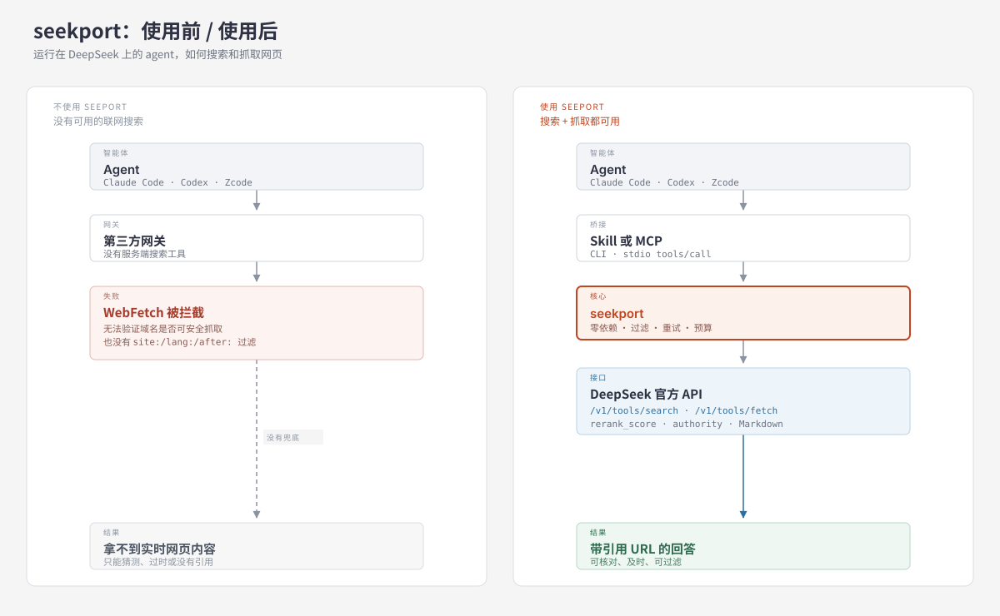

<p align="right"><a href="README.en.md"></a></p>

<h1 align="center">seekport</h1>

<p align="center"><strong>把 DeepSeek 官方的 Search / Fetch API 接到 Claude Code、Codex、Zcode 以及其他 agent harness</strong></p>
<p align="center">零依赖 · Agent Skill + MCP · 先搜索候选，再抓取原文</p>
<p align="center"><strong>v0.1.3 — Full-width Tables and Bilingual About</strong></p>

<p align="center">
  <a href="https://github.com/ChemistryBus/seekport/actions/workflows/test.yml"></a>
  <a href="https://github.com/ChemistryBus/seekport/releases"></a>
  <a href="LICENSE"></a>
  
  
  
</p>



## 它是什么

搜索工具并不缺，难的是**在第三方网关和不同 harness 之间，让 agent 稳定拿到可引用的原文**。

`seekport` 不是爬虫，也不是搜索引擎。它是一个很薄的桥接层：把 query 或 URL 交给 DeepSeek 官方的 Search / Fetch API，拿回排序结果或 Markdown，再交给 agent 使用。

它主要解决四类问题：

- 第三方网关下，Claude Code 的 `WebFetch` 报 `Unable to verify if domain is safe to fetch`；
- harness 的内置搜索不可用，或无法使用 DeepSeek 的 `site:` / `lang:` / `after:` 与 `rerank_score` / `authority` 过滤；
- 只能引用二手文章，信息可能过时；
- 不同 harness 的接入方式不同：有的能跑 shell，有的只能调 MCP。

**它不是什么**：不是爬虫，不解析 HTML、不跟链接、不建索引；不是通用搜索引擎；不是 PubMed / Web of Science / Scopus；不是 DeepSeek 官方项目。

和其他工具的关系：DSH 用户直接用 `@deepseek-ai/dsh-web-deepseek-api`；OpenCode / Pi 有 `deepseek-web-retrieval`；通用 MCP 有 `@wangkh/deepseek-search-mcp`；纯 skill 有 `namelessgod2008/deepseek-search`。seekport 的差异是：非 DSH harness + 标准 Skill + 零依赖 + 过滤与预算。

## 30 秒开始

### 方式一：让 agent 帮你装

把下面这段直接发给 Claude Code / Codex / Zcode：

```text
帮我安装 seekport 这个 Agent Skill。请先确认是否允许写入 ~/.claude/skills，然后：
1. git clone https://github.com/ChemistryBus/seekport.git ~/.claude/skills/seekport
2. 检查 SKILL.md、scripts/cli.py 是否存在
3. 告诉我怎么设置 DEEPSEEK_API_KEY
不要读取或上传我的 API key。
```

### 方式二：手动安装

```bash
git clone https://github.com/ChemistryBus/seekport.git ~/seekport
ln -s ~/seekport ~/.claude/skills/seekport
export DEEPSEEK_API_KEY=sk-...
```

重启 Claude Code，然后直接说：

> 用 seekport 搜一下 Nutrients 最新的作者投稿指南

### 先试一次搜索

```bash
python3 scripts/cli.py search "Nutrients author guidelines site:mdpi.com" --md
python3 scripts/cli.py fetch "https://api-docs.deepseek.com/zh-cn/guides/search" --md
```

不需要 `pip install`。要求 Python 3.9+。

## 怎么搜

<table width="100%">
  <thead><tr><th width="24%">你手上的任务</th><th width="46%">推荐写法</th><th width="30%">为什么</th></tr></thead>
  <tbody>
    <tr><td>查期刊投稿指南</td><td><code>site:mdpi.com</code> + 关键词</td><td>限定站点，少看无关结果</td></tr>
    <tr><td>查官方 API 文档</td><td><code>site:api-docs.deepseek.com</code></td><td>官网优先，避免二手文章</td></tr>
    <tr><td>查最新进展</td><td><code>after:2025 lang:en</code></td><td>限定年份和语言</td></tr>
    <tr><td>引用原文</td><td><code>fetch &lt;url&gt;</code></td><td>搜索只是候选，原文才可引用</td></tr>
    <tr><td colspan="3">注：搜索返回的是候选，适合先看摘要；要引用原文，再对具体 URL 执行 fetch。多个站点可以用 OR 组合 site:，例如 site:github.com OR site:huggingface.co。</td></tr>
  </tbody>
</table>

```bash
# 1. 查期刊投稿指南
python3 scripts/cli.py search "Nutrients author guidelines site:mdpi.com" --md

# 2. 查官方 API 文档
python3 scripts/cli.py search "DeepSeek pricing site:api-docs.deepseek.com" --md

# 3. 查某个方向的最新进展
python3 scripts/cli.py search "exercise metabolism after:2025 lang:en" --md

# 4. 搜到候选后，抓取原文
python3 scripts/cli.py fetch "https://api-docs.deepseek.com/zh-cn/guides/search" --md
```

<table width="100%">
  <thead><tr><th width="30%">语法</th><th width="70%">作用</th></tr></thead>
  <tbody>
    <tr><td><code>site:</code></td><td>限定站点</td></tr>
    <tr><td><code>-site:</code></td><td>排除站点</td></tr>
    <tr><td><code>"..."</code></td><td>精确短语</td></tr>
    <tr><td><code>-词</code></td><td>排除词</td></tr>
    <tr><td><code>lang:zh,en</code></td><td>限定语言</td></tr>
    <tr><td><code>after:</code> / <code>before:</code></td><td>限定时间</td></tr>
    <tr><td colspan="2">注：多个操作符可以组合使用，空格分隔；搜索语法会原样传给 DeepSeek，不会在本地解析或改写。引号内可以包含空格，-词 用于排除。</td></tr>
  </tbody>
</table>

<table width="100%">
  <thead><tr><th width="30%">参数</th><th width="70%">说明</th></tr></thead>
  <tbody>
    <tr><td><code>--count</code></td><td>返回 1–50 条，默认 10；不影响单次计费</td></tr>
    <tr><td><code>--min-rerank</code></td><td>低于该分数丢弃，默认 1.5；<code>0</code> 表示不过滤</td></tr>
    <tr><td><code>--min-authority</code></td><td>低于该权威性丢弃；<code>3</code>–<code>4</code> 为极权威</td></tr>
    <tr><td><code>--md</code></td><td>输出 Markdown 而非 JSON</td></tr>
    <tr><td><code>--content</code></td><td>让 API 返回网页正文（更大更慢）</td></tr>
    <tr><td><code>--ori-question</code></td><td>用户原始问题，帮助理解搜索意图</td></tr>
    <tr><td colspan="2">注：--count 只影响返回条数，不影响单次价格；--min-rerank 0 会保留所有有分数的结果，--min-authority 3 只保留高权威来源。过滤在本地完成。</td></tr>
  </tbody>
</table>

## 适合 / 不适合

**适合：**

- 用 Claude Code / Codex / Zcode 跑 DeepSeek 的人；
- 走第三方网关，`WebFetch` 被拦的人；
- 科研写论文，需要查官方文档、期刊投稿指南、会议 deadline 的人；
- 希望结果先过滤、再进模型，控制 token 和费用的人。

**不适合：**

- 需要 PubMed / Web of Science / Scopus 这类学术数据库；
- 需要批量爬取、建索引或定时抓取；
- 不想为 DeepSeek API 付费；
- 不能运行 Python 3.9+ 或没有网络访问。

## 核心能力

<table width="100%">
  <thead><tr><th width="30%">能力</th><th width="70%">说明</th></tr></thead>
  <tbody>
    <tr><td>带过滤的搜索</td><td>支持 <code>site:</code> / <code>lang:</code> / <code>after:</code>；默认丢弃 <code>rerank_score &lt; 1.5</code>，可加 <code>--min-authority 3</code></td></tr>
    <tr><td>抓取原文</td><td>把 URL 抓成 Markdown，交给 agent 总结或引用</td></tr>
    <tr><td>两种形态</td><td>Agent Skill 或 stdio MCP server（<code>deepseek_search</code> / <code>deepseek_fetch</code>），共用同一份核心</td></tr>
    <tr><td>成本护栏</td><td>408 / 429 / 5xx 退避重试；拒绝重定向；<code>SEEKPORT_BUDGET</code> 每日预算</td></tr>
    <tr><td>零依赖</td><td>纯 Python 3.9+ 标准库，核心 <code>scripts/ds_core.py</code> 290 行</td></tr>
    <tr><td colspan="2">注：核心逻辑在 scripts/ds_core.py，CLI 与 MCP 共用同一份实现；81 个单测全部 mock HTTP，不消耗额度。零依赖指运行时只用 Python 标准库。</td></tr>
  </tbody>
</table>

## 证据，不是“准确率”

问 agent：“DeepSeek 的网页搜索 API 怎么收费？QPS 多少？”在第三方网关后面，`WebFetch` 读官方文档会报：

> Unable to verify if domain is safe to fetch.

搜索返回的第三方文章中，前三条有两条仍写着 **$0.75/千次、5 QPS**。用 seekport 抓取官方原文后看到的是 **¥5/千次、Search 100 QPS / Fetch 25 QPS**。

这是开发者的真实操作记录，不是第三方用户案例，也不是通用准确率。一次搜索 + 一次抓取约 **¥0.01**。完整记录见 [examples/case-study.md](examples/case-study.md)。

## 支持哪些 harness

<table width="100%">
  <thead><tr><th width="30%">Harness</th><th width="70%">状态</th></tr></thead>
  <tbody>
    <tr><td>Claude Code</td><td>已实测（Skill + CLI）</td></tr>
    <tr><td>Codex</td><td>安装说明已写；未在客户端内部逐一验证</td></tr>
    <tr><td>Zcode</td><td>安装说明已写；未在客户端内部逐一验证</td></tr>
    <tr><td>任意 MCP 客户端</td><td>MCP stdio 已实测；适合不能执行 shell 的 harness</td></tr>
    <tr><td colspan="2">注：Claude Code、CLI 与 MCP stdio 已实测；Codex、Zcode 只写了安装说明，尚未在客户端内部逐一验证；Windows 未测试。每个 harness 只装一种形态。</td></tr>
  </tbody>
</table>

平台：macOS 已测；Linux 由 CI 覆盖（Python 3.9 / 3.11 / 3.12）；Windows 未测试。

每个 harness 只装一种形态：能跑 shell 选 Skill；不能跑 shell 选 MCP。

## 安装选项

**Skill（Claude Code / Codex / Zcode）**

```bash
git clone https://github.com/ChemistryBus/seekport.git ~/seekport
ln -s ~/seekport ~/.claude/skills/seekport
```

**MCP（不能执行 shell 的客户端）**

```bash
claude mcp add seekport -- python3 "/绝对路径/seekport/mcp/seekport_mcp.py"
```

**CLI（直接使用）**

```bash
python3 scripts/cli.py search "..." --md
python3 scripts/cli.py fetch "https://..." --md
```

## 成本与限速

<table width="100%">
  <thead><tr><th width="30%">项目</th><th width="70%">数值</th></tr></thead>
  <tbody>
    <tr><td>Search</td><td><strong>每 1,000 次成功请求 ¥5</strong></td></tr>
    <tr><td>Fetch</td><td><strong>每 1,000 次成功请求 ¥5</strong></td></tr>
    <tr><td>单次约</td><td>¥0.005 ≈ <strong>$0.0007</strong></td></tr>
    <tr><td>计费条件</td><td>HTTP 200 <strong>且</strong> Search 结果非空 / Fetch 有正文</td></tr>
    <tr><td>不计费</td><td>报错、超时、空搜索结果</td></tr>
    <tr><td>限速</td><td>Search <strong>100 QPS</strong>，Fetch <strong>25 QPS</strong>（按账号）</td></tr>
    <tr><td colspan="2">注：价格与限速以 DeepSeek 官方文档为准；只有 HTTP 200 且结果非空才计费，空结果、报错和超时不计费。设置 SEEKPORT_BUDGET 可以限制每日花费。</td></tr>
  </tbody>
</table>

`--count` 只改返回条数，不改价格。设置 `SEEKPORT_BUDGET=0.05` 可把每日花费限制在 ¥0.05（10 次成功调用），账本在 `~/.cache/seekport/spend.log`。价格和限速可能变化，引用前请看[官方文档](https://api-docs.deepseek.com/zh-cn/guides/search)。

## 常见问题

**和 `@deepseek-ai/dsh-web-deepseek-api` 有什么区别？**

DSH 用户直接用官方包；seekport 面向非 DSH harness、第三方网关，以及需要显式过滤和预算上限的人。

**需要付费吗？**

工具本身 MIT 免费；DeepSeek 的 Search / Fetch API 按次收费，约 ¥0.005 / 次，空结果和报错不计费。

**支持 Windows 吗？**

代码是纯标准库，但 Windows 尚未测试；macOS 和 Linux CI 已测试。

**Codex / Zcode 验证过吗？**

安装说明已写入 README；本次实测的是 Claude Code（Skill）、CLI 和 MCP stdio。Codex / Zcode 尚未在客户端内部逐一验证。

**为什么 WebFetch 会报错？**

第三方网关不认目标域名，`WebFetch` 无法验证安全性。seekport 把 URL 交给 DeepSeek 的 Fetch API，由服务端抓取。

**抓取失败怎么办？**

可能返回 403 / 404，或目标站点有付费墙 / 反爬。换一个 URL，或改用搜索结果的 `summary`。

**会把 API key 写进仓库吗？**

不会。key 只从 `DEEPSEEK_API_KEY` 读取；仓库不含 key；重定向被拒绝，token 不会被转发到其它 origin。

## 文档

<table width="100%">
  <thead><tr><th width="30%">主题</th><th width="70%">链接</th></tr></thead>
  <tbody>
    <tr><td>英文 README</td><td><a href="README.en.md">README.en.md</a></td></tr>
    <tr><td>Skill 说明</td><td><a href="SKILL.md">SKILL.md</a></td></tr>
    <tr><td>真实案例</td><td><a href="examples/case-study.md">examples/case-study.md</a></td></tr>
    <tr><td>维护清单</td><td><a href="MAINTENANCE.md">MAINTENANCE.md</a></td></tr>
    <tr><td>贡献指南</td><td><a href="CONTRIBUTING.md">CONTRIBUTING.md</a></td></tr>
    <tr><td>小红书 / 视频素材</td><td><a href="promo/README.md">promo/README.md</a></td></tr>
    <tr><td>发布说明</td><td><a href="https://github.com/ChemistryBus/seekport/releases">GitHub Releases</a></td></tr>
    <tr><td colspan="2">注：中文 README 是默认入口，英文在 README.en.md；SKILL.md 是安装后的技能说明，examples/ 里是真实输出，promo/ 里是小红书和视频素材。</td></tr>
  </tbody>
</table>

## 开发与测试

```bash
python3 -m unittest discover -s tests -v
```

81 个测试，行覆盖率 93%，CI 在 Python 3.9 / 3.11 / 3.12 上运行。全部 HTTP 均为 mock，不消耗额度。

## 致谢

搜索与抓取由 DeepSeek 官方 Search/Fetch API 提供。本项目使用 Claude Code（底层为 DeepSeek 模型）开发。这些是工具，不是作者：GitHub 的 contributors 列表反映的是提交代码的人，而不是使用的模型或 API。

## 许可

MIT。与 DeepSeek 官方无关。
