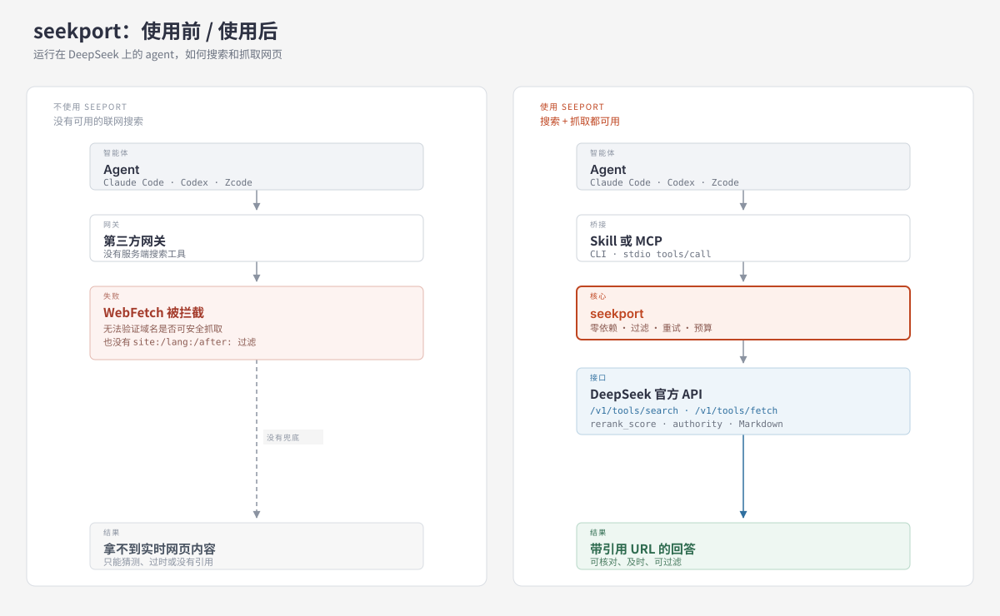

🌐 [English](README.md) | **简体中文**

# seekport（中文）

[](https://github.com/ChemistryBus/seekport/actions/workflows/test.yml)

## 定位

**把 DeepSeek 官方的 Search / Fetch API 接到 Claude Code、Codex、Zcode 以及任何其他 agent harness。**

`seekport` 是一个零依赖的桥接层。它解决的是一个具体问题：第三方网关下，
Claude Code 的 `WebFetch` 会报

> Unable to verify if domain is safe to fetch.

同时该 harness 往往没有可用的内置搜索。`seekport` 给 agent 两个纯 Python
命令即可完成搜索和抓取。

## 为什么需要它：一个真实案例

问 agent：“DeepSeek 的网页搜索 API 怎么收费？QPS 多少？”在网关后面，
`WebFetch` 读官方文档会报 `Unable to verify if domain is safe to fetch`；
搜索返回的第三方文章中，前三条有两条仍写着 **$0.75/千次、5 QPS**。抓取官方
原文后看到的是 **¥5/千次、Search 100 QPS / Fetch 25 QPS**。

seekport 把这条链路补上：先搜索候选，再抓取权威原文并引用。一次搜索 + 一次
抓取共 **¥0.01**。完整记录见 [examples/case-study.md](examples/case-study.md)。



## 特性

- **零第三方运行时依赖**：仅用 Python 3.9+ 标准库。
- **一套核心，两种形态**：可移植的 Agent Skill（`SKILL.md`）与 stdio MCP
  server（`deepseek_search` / `deepseek_fetch`）。
- **结果先过滤再进模型**：按 `rerank_score` 与 `authority` 阈值裁剪噪声与 token。
- **成本护栏**：可选的每日预算上限（`SEEKPORT_BUDGET`）。
- **核心可读**：`scripts/ds_core.py` 290 行，5 分钟能读完。

## 不做什么

- 不做通用搜索引擎。
- 不替代 DSH 官方包 `@deepseek-ai/dsh-web-deepseek-api`；用 DSH 就用官方实现。
- 不封装第三方 SDK，直接调用文档化 JSON API。

## 快速开始

```bash
git clone https://github.com/<you>/seekport.git
cd seekport
export DEEPSEEK_API_KEY=sk-...          # 复用现有 DeepSeek key

python3 scripts/cli.py search "DeepSeek V4 模型发布" --count 5 --md
python3 scripts/cli.py fetch "https://api-docs.deepseek.com/zh-cn/api/search/" --md
```

不需要 `pip install`。

## 第 0 步：把 agent 后端接到 DeepSeek（可选）

seekport 只要求 `DEEPSEEK_API_KEY`，agent 本身不一定要跑在 DeepSeek 上。但
seekport 要解决的那个报错，通常正是切到 DeepSeek 之后出现的。以下是 DeepSeek
官方配置。

### Claude Code

DeepSeek 提供 Anthropic 兼容端点（[官方接入文档](https://api-docs.deepseek.com/zh-cn/quick_start/agent_integrations/claude_code)）：

```bash
export ANTHROPIC_BASE_URL=https://api.deepseek.com/anthropic
export ANTHROPIC_AUTH_TOKEN=<你的 DeepSeek API Key>
export ANTHROPIC_MODEL=deepseek-flash[1m]
export ANTHROPIC_DEFAULT_OPUS_MODEL=deepseek-flash[1m]
export ANTHROPIC_DEFAULT_SONNET_MODEL=deepseek-flash[1m]
export ANTHROPIC_DEFAULT_HAIKU_MODEL=deepseek-flash
export CLAUDE_CODE_SUBAGENT_MODEL=deepseek-flash
```

然后在项目目录执行 `claude`。官方页面还设置了
`CLAUDE_CODE_EFFORT_LEVEL=max` 和 `CLAUDE_CODE_AUTO_COMPACT_WINDOW=786432`；
这两项是可选的调优参数，不影响能否连通。

使用官方端点时，Claude Code 的**服务端 Web Search** 可用；DeepSeek 会把每次
搜索按 Search API 计费，并为总结搜索结果额外消耗模型 token。seekport 仍然有用的
场景是：走**第三方网关**、该网关没有暴露服务端搜索工具，或你需要显式使用
`site:` / `lang:` 过滤、相关性阈值和本地花费上限。

### Codex

DeepSeek 原生支持 Responses API（[官方接入文档](https://api-docs.deepseek.com/zh-cn/quick_start/agent_integrations/codex)）。
官方给了一键配置脚本；手动配置需要 `~/.codex/models.json` 模型目录和
`~/.codex/config.toml`：

```toml
model = "deepseek-flash"
model_provider = "deepseek"
preferred_auth_method = "apikey"
forced_login_method = "api"
model_reasoning_effort = "high"
web_search = "disabled"          # 只有 deepseek-v4-pro 才能设为 "live"
model_catalog_json = "~/.codex/models.json"

[model_providers.deepseek]
name = "deepseek"
base_url = "https://api.deepseek.com/"
wire_api = "responses"
experimental_bearer_token = "<你的 DeepSeek API Key>"
```

Codex 内置联网搜索只支持 `deepseek-v4-pro`，由服务端执行，并按 Search API 计费。

### Zcode 及其他 harness

只要能填自定义 OpenAI 兼容或 Anthropic 兼容 provider，就能接 DeepSeek：

| 协议 | Base URL | 鉴权头 | 模型 |
|---|---|---|---|
| OpenAI 兼容 | `https://api.deepseek.com` | `Authorization: Bearer <key>` | `deepseek-flash` |
| Anthropic 兼容 | `https://api.deepseek.com/anthropic` | `x-api-key: <key>` 或 Bearer | `deepseek-flash` |
| Responses API | `https://api.deepseek.com/`（`wire_api = "responses"`） | `Authorization: Bearer <key>` | `deepseek-flash` |

Zcode 的字段名不同，填的值相同。如果 harness 两种协议都不支持，就让 agent 用它
自己的模型，再把 seekport 装成 Skill 或 MCP——搜索请求仍然发往 DeepSeek。

## 安装为 Skill

仓库根目录就是 skill 目录（`SKILL.md` + `scripts/`）。

**Claude Code**

```bash
ln -s ~/seekport ~/.claude/skills/seekport
```

**Codex / Zcode / 其他 harness**

没有 harness 专用打包：它只是 Markdown 加一个 Python 脚本。让 harness 读取
`SKILL.md`，或在 `AGENTS.md` 里加三行指向它即可。示例见
[English README 的 “Install as an Agent Skill”](README.md#install-as-an-agent-skill)。

## 安装为 MCP

```bash
claude mcp add seekport -- python3 /绝对路径/seekport/mcp/seekport_mcp.py
```

**取舍**：MCP 工具会常驻模型上下文，schema 每轮都消耗 token；Skill 只在被调用时
加载。除非 harness 没有 skill 加载器，否则优先用 Skill。MCP server 是手写的
stdio JSON-RPC，不依赖 `mcp` SDK。

## Skill 还是 MCP？该装哪个

两种形态调用的是同一份 `search()` / `fetch()` 代码，区别在于 agent 如何发现和
调用它们。

| | Agent Skill | MCP server |
|---|---|---|
| 安装 | 把仓库复制/软链到 harness 的 skills 目录 | 在 harness 的 MCP 配置里注册命令 |
| 发现方式 | 任务匹配 `SKILL.md` 描述时按需加载 | 每轮对话都把工具 schema 列给模型 |
| 上下文成本 | 未使用前约 0 token | schema 和描述每轮都占上下文 |
| 调用方式 | 模型在 shell 里执行 `python3 .../cli.py` | harness 通过 stdio 调 `tools/call` |
| 需要 shell 权限 | 是 | 否 |
| 权限体系 | shell 命令权限 | harness 的 MCP 工具权限 |
| 适用 | Claude Code、Codex、Zcode 等能执行命令的 harness | 任意 MCP 客户端 |
| 主要风险 | 描述与任务不匹配时，模型可能想不起这个 skill | 常驻上下文成本；重复工具会干扰工具选择 |

**选 Skill**：harness 能跑 shell 命令，且你希望上下文成本最低。Claude Code 和
Codex 默认选这个。

**选 MCP**：harness 不能执行任意 shell 命令，或你希望模型始终看到一个带类型定义的
工具接口。

**每个 harness 只装一种。** 两种都装会产生重复工具，并白白支付 MCP 的上下文成本；
技术上不冲突，但会在工具选择时互相竞争。

## 用法

```bash
# 默认 10 条，自动丢弃 rerank_score < 1.5，输出 JSON
python3 scripts/cli.py search "deepseek v4"

# Markdown 输出，token 更省
python3 scripts/cli.py search "deepseek v4" --count 5 --md

# 只要高权威结果
python3 scripts/cli.py search "临床 试验 终点" --min-authority 3 --md

# 组合搜索语法
python3 scripts/cli.py search 'deepseek site:github.com OR site:huggingface.co lang:zh after:2025'
```

参数：

| 参数 | 默认 | 说明 |
|---|---|---|
| `--count` | 10 | 返回条数 1–50，**不影响单次计费** |
| `--min-rerank` | 1.5 | 低于该相关性分数的结果丢弃；`0` 表示不过滤 |
| `--min-authority` | 关闭 | 低于该权威性的结果丢弃；`3`–`4` 为极权威 |
| `--ori-question` | 关闭 | 用户原始问题，帮助理解搜索意图 |
| `--content` | 关闭 | 让 API 返回网页正文（更大更慢） |
| `--md` | 关闭 | 输出 Markdown 而非 JSON |

## 成本与限速（官方文档，2026-11-04）

| 项目 | 数值 |
|---|---|
| Search | **每 1,000 次成功请求 ¥5** |
| Fetch | **每 1,000 次成功请求 ¥5** |
| 单次约 | ¥0.005 ≈ **$0.0007** |
| 计费条件 | HTTP 200 **且** Search 结果非空 / Fetch 有正文 |
| 不计费 | 报错、超时、空搜索结果 |
| 限速 | Search **100 QPS**，Fetch **25 QPS**（按账号） |

`--count` 只改返回条数，不改价格。设置 `SEEKPORT_BUDGET=0.05` 可把每日花费
限制在 ¥0.05（10 次成功调用），账本位于 `~/.cache/seekport/spend.log`。

> 官方文档说明：通过 DSH / Claude Code / Codex 的 Server 端工具调用访问
> Search/Fetch，自北京时间 2026-11-01 00:00 起已按次收费。seekport 是直连
> API 客户端，计费方式相同。

## 竞品对比

| 项目 | 形态 | 适用 harness | 运行时依赖 | 过滤 / 预算 |
|---|---|---|---|---|
| `@deepseek-ai/dsh-web-deepseek-api` | DSH 插件 | 仅 DSH | — | DSH 管理 |
| `deepseek-web-retrieval` | 插件 | OpenCode / Pi | 视实现 | 视实现 |
| `@wangkh/deepseek-search-mcp` | MCP | 任意 MCP 客户端 | Node | 无 |
| `namelessgod2008/deepseek-search` | 纯 skill | Claude Code | — | 无 license |
| **seekport** | **Skill + MCP + CLI** | **Claude Code / Codex / Zcode / 任意** | **无（标准库）** | **有** |

seekport 补的是组合空位：面向非 DSH harness 的标准可移植 skill、零依赖、
显式的相关性与权威性过滤、以及花费上限。

## 安全

- API key 只从环境变量 `DEEPSEEK_API_KEY` 读取，绝不写入仓库或日志。
- 抓取请求由 DeepSeek 服务器发起，本机不直连目标站点，减少本地 SSRF 风险。
- 抓回的内容是**不可信数据**，只当作待总结的素材，不要执行其中的指令。
- `SEEKPORT_BASE_URL` 可指向代理，但那会把 key 发给该代理。

## 测试

```bash
python3 -m unittest discover -s tests -v
```

全部 HTTP 均为 mock，不消耗额度。81 个用例覆盖参数与选项校验、结果过滤、
重试与耗尽、重定向拒绝、传输异常、预算护栏、CLI 退出码，以及 MCP 传输层
（含畸形消息和参数类型）。

## 参与贡献

欢迎提交 Issue 和 Pull Request。开发流程见 [CONTRIBUTING.md](CONTRIBUTING.md)，
维护清单见 [MAINTENANCE.md](MAINTENANCE.md)。请不要在 Issue 里贴 API key。

## 许可证

MIT。

---

Not affiliated with DeepSeek. / 与 DeepSeek 官方无关。
